<a href="https://aarush.work/">
  
</a>

<p align="center">
  <a href="https://aarush.work/"></a>
  <a href="https://www.linkedin.com/in/aarushnarang/"></a>
  <a href="mailto:aarushnarang@arizona.edu"></a>
  <a href="https://link.springer.com/chapter/10.1007/978-3-031-68309-1_18"></a>
</p>

<br />

I'm drawn to problems where being right matters: a near miss at an intersection, a finding on a chest X-ray, a ticket that has been waiting since morning. I spent two years shipping production ML at **HCL Technologies**, presented a paper at **DEXA 2024** in Naples, and I'm now doing an **MS in Data Science at the University of Arizona** while working on applied ML at **Biosphere 2** and with **Amazon** through the Eller Immersion Project. I care more about honest evaluation than leaderboards.

<p align="center">
  <b>Open to full time roles from 2027</b><br /><br />
  
  
  
</p>


### `$ now`

| where | what |
|:---|:---|
| **Amazon** · Eller Immersion Project | Forecasting weather driven delivery capacity loss **5 days ahead** at region level. Distributed lag logistic regression vs. an XGBoost / LightGBM / CatBoost ensemble with monotonic constraints and SHAP, walk forward backtests grouped by storm event, plus a simulation of the Return to Station re-induction cycle. |
| **Biosphere 2** · AI/ML & Software Engineer | Sensor data quality layer in Oracle SQL over a **26 table** schema and **58 sensors**, tested on **10,000+** real readings, with edge telemetry traced from an in-farm Raspberry Pi (Tailscale, SSE, SQLite) to Spring Boot on AWS ECS Fargate. |
| **University of Arizona** · MS Data Science | GPA 3.83 · graduating May 2027 |


### `$ cat impact.log`



<details>
<summary><b>How those numbers were built</b></summary>
<br />

- **RAG assistant** over 4,000+ SharePoint and ServiceNow files: Qwen3-Embedding, pgvector hybrid BM25 search, Qwen3-Reranker, heading aware 512 token chunks, measured on a 935 question labeled set.
- **MCP server** for incident lookup, priority escalation and ticket reassignment, gated by unit and eval regression suites and shipped through GitHub Actions with zero downtime.
- **Employee cost models** (Python, pandas, FastAPI, Azure SQL) within 7% MAPE of actual, running weekly on Azure App Service via Docker and Azure DevOps.
- **Sales KPP** (React, C#, .NET, MS SQL Server) replacing manual Excel consolidation for HR, PMO and L2 leadership.

</details>


### `$ ls ./projects`

<p align="center">
  <a href="https://github.com/aarushnarang02/reflex"></a>
  <a href="https://github.com/aarushnarang02/radarmd"></a>
</p>

**Research code**

- [`valley-fever-patient-grouping`](https://github.com/aarushnarang02/valley-fever-patient-grouping): grouping Valley Fever patients by symptoms and social determinants with a mixed type latent class model, plus a permutation null that tests whether the groups are real.
- [`autism-video-data-collection`](https://github.com/aarushnarang02/autism-video-data-collection): locating public video for autism research behind an auditable consent and licence gate. Metadata only, never downloads media.


### `$ cat publication.bib`

> **Analyzing the Efficacy of Large Language Models: A Comparative Study**
> 35th International Conference on Database and Expert Systems Applications (**DEXA 2024**), Naples, Italy · Springer LNCS
> [Read the paper →](https://link.springer.com/chapter/10.1007/978-3-031-68309-1_18)


### `$ stack --list`

<p align="center">
  <br />
  
</p>

```yaml
llm_systems:   [RAG, MCP, LangChain, Hugging Face, hybrid search, BM25, reranking, pgvector]
vision:        [YOLO11, ByteTrack, MONAI, timm, Grad-CAM, ONNX, TensorRT]
modeling:      [XGBoost, LightGBM, CatBoost, SHAP, PyTorch Lightning, Weights & Biases]
data:          [PostgreSQL, Oracle, Azure SQL, Neo4j, Cassandra, HBase, SQLite]
ship:          [Docker, GitHub Actions, Cloud Run, ECS Fargate, Azure App Service, Prometheus]
```


<p align="center">
  Happy to talk about retrieval, evaluation, computer vision, or anything where the model has to be right.<br /><br />
  <a href="https://aarush.work/#contact">Say hello →</a>
</p>
